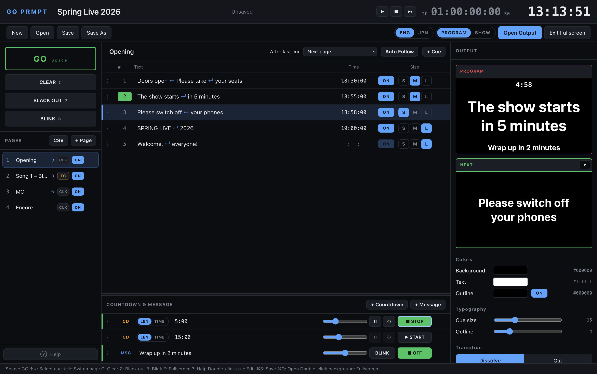

# GO PRMPT

[English](README.md) | **日本語**

ライブやイベントのためのキュー式プロンプターです。Cue リストに並べた文言を、別ウィンドウ（出力ウィンドウ）に 1 つずつ出します。Space キーでの手動実行のほか、時刻やタイムコード（MTC / LTC）での自動実行もできます。

> [!IMPORTANT]
> **パソコンの Chrome 専用です。スマートフォンやタブレットでは使えません。** キーボード操作・別ウィンドウでの出力・Web MIDI やファイルの保存など Chrome の機能を使っているためです。

**アプリを開く：https://hugesesame.github.io/go-prmpt/**

> **ベータ版です。** GO PRMPT はまだ検証中で、実際の本番では使っていません。MTC と LTC は、ソフトウェアの送り元とオーディオの折り返しでしか確認しておらず、ハードウェアの機材では試していません。本番で使う前に、実際の機材で試してください。



## 主な機能

- ページに分けた Cue リスト。Space キーで GO、次に出る Cue を NEXT でプレビュー
- 16:9 の出力ウィンドウ（外部ディスプレイがあればそちらに開く）
- 出力に重ねるカウントダウンとメッセージ
- 時刻・タイムコードでの自動実行（MTC 受信・LTC 受信・内部生成と MTC / LTC 出力）
- CLEAR・BLACK OUT・BLINK、ディゾルブ／カット、色とアウトラインの設定
- 本番中に編集をロックする SHOW モード
- ショーファイルの保存と読み込み、CSV からの読み込み
- 英語・日本語の画面

## はじめ方

1. パソコンの Chrome でアプリを開きます。
2. ツールバーの「出力ウィンドウを開く」を押し、出力ウィンドウを表示したい画面に移します（`F` キーでフルスクリーン）。
3. 詳しい使い方は、`?` キーか左下の「ヘルプ」ボタンで見られます。

サンプルで試すときは、[`samples/sample-show.json`](samples/sample-show.json) をダウンロードし、「開く」で読み込んでください。

## ショーの保存場所

- ショーは、作業中にそのパソコンのブラウザへ自動で保存されます。
- どこにも送信されません。別のパソコンや、同じパソコンの別のブラウザには入っていません。
- ブラウザのサイトデータを消去すると、ショーも消えます。
- 「保存」（`⌘S`）で、ショーを好きな場所にファイルとして保存できます。バックアップを取るときと、別のパソコンへ「開く」で移すときに使います。
- 同じアプリを複数のタブで開くと、黄色い警告が出ます。お互いの編集を上書きしてしまうので、1 つだけ残して閉じてください。

## 回線がないとき

- 一度開けば、回線が切れてもそのまま動き続けます。タイムコード、MIDI、出力ウィンドウは、インターネットを使いません。
- アプリは、自分自身の控えもブラウザに保存します。画面の右下に **Offline ready**（日本語の画面では「オフライン対応」）と出ていれば、そのパソコンでは回線がなくても、開き直しや再読み込みができます。出力ウィンドウも開けます。
- 回線のない現場へ持っていくパソコンは、回線のある場所で一度開き、この表示を確かめておいてください。
- 回線があるときは、開くたびに最新の版を読み込みます。

## 手元のパソコンで動かす

アプリを改造したい人や、自分でビルドしたい人向けの説明です。使うだけなら不要で、上のリンクを開けば使えます。Node.js 20.19 以上（または 22.12 以上）が必要です。

```bash
npm install
npm run dev
```

ターミナルに表示されたアドレス（通常は http://localhost:5173/）を開きます。

| コマンド | 内容 |
|---|---|
| `npm run dev` | 開発サーバーを起動。コードを直すとすぐ画面に反映される |
| `npm run build` | 型チェックをして、`dist/` にアプリをビルド |
| `npm run preview` | ビルドした `dist/` のアプリを手元で開く |

公開版と手元で動かした版は、動作が少し違います。

| | 公開版 | 手元の開発サーバー（localhost） |
|---|---|---|
| 必要なもの | Chrome | Chrome と Node.js |
| インターネット | 最初の 1 回だけ必要 | 不要 |
| 保存されるショーと設定 | 公開版用に保存 | localhost 用に保存 |
| マイク・MIDI・画面の配置の許可 | 公開版で許可 | localhost で改めて許可 |

ショーの保存場所は、それぞれ別です。ショーを移すときは「保存」と「開く」を使います。

| 場所 | 中身 |
|---|---|
| `src/primary/` | メイン画面：Cue リスト、ページ、カウントダウン・メッセージ、タイムコードの処理、ヘルプ |
| `src/output/` | 出力ウィンドウ |
| `src/components/` | 両方の画面で使う部品（出力の表示、カラーピッカーなど） |
| `src/state.ts` | アプリ全体の状態と操作 |
| `src/timecode.ts`、`src/mtc.ts`、`src/ltc.ts` | タイムコードの計算、MTC と LTC の読み取りと生成 |
| `src/csv.ts`、`src/fileio.ts` | CSV の読み込み、ショーファイルの保存と読み込み |
| `src/i18n.tsx` | 英語と日本語の文言 |

React、TypeScript、Vite で作っています。

## ライセンス

[MIT](LICENSE) です。仕事の現場を含め、自由に使用、改造、再配布ができます。動作の保証はありません。
